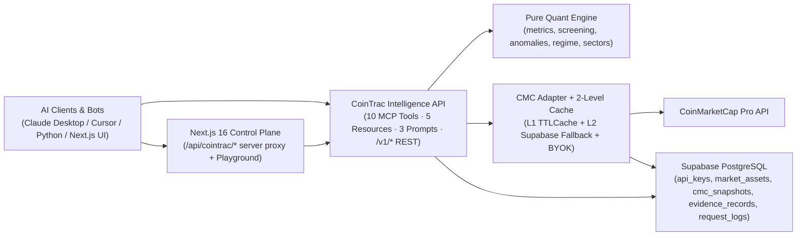

# CoinTrac — Crypto Market Intelligence MCP & REST Platform

**Verified crypto market intelligence for your AI agent — sourced, timestamped, CoinMarketCap-powered analytics with explicit freshness and declared limitations.**

> **Namespace:** CoinTrac uses `/api/cointrac/*`, `Authorization: Bearer <key>` or `x-cointrac-key`, `ct_live_*` API keys, `cointrac://*` MCP resource URIs, and the `cointrac-intelligence-v1.0.0` engine default.

- **Core Stack:** Python 3.12 · FastAPI · Official Python MCP SDK (`MCPServer`) · NumPy/Pandas · Supabase PostgreSQL · Next.js 16 (App Router) Developer Control Plane
- **Zero Server-Side LLM Calls:** 100% deterministic quantitative analytics (`sqrt(365)` crypto annualization, honest `null` handling for missing data, canonical `cmc_id` resolution).
- **Control Plane / Workspace:** Local Next.js app (`http://localhost:3000`; public hosting pending deployment)
- **MCP Endpoint (Streamable HTTP):** Local default `http://localhost:8000/mcp` *(public HTTPS MCP deployment pending)*

---

## Architecture

Every MCP tool and REST endpoint calls the exact same async workflow in `apps/intelligence/app/services/intelligence.py`, returning a canonical `EvidenceEnvelope[T]` and persisting an audit row to Supabase `evidence_records`.



### Monorepo Layout

```text
apps/
├── intelligence/   # FastAPI + Streamable HTTP/stdio MCP Server + Pure Quant Engine
└── web/            # Next.js 16 Control Plane (Overview, Playground, Evidence, Connect)
scripts/
├── probe_cmc.py               # Live CMC endpoint capability prober
└── seed_verified_snapshots.py # Pre-deadline verified snapshot & market_assets seeder
supabase/
├── migrations/001_initial_schema.sql
└── seed.sql
examples/
├── claude_desktop_config.json
├── cursor_mcp_config.json
└── python_rest_client.py
docs/
└── CMC_CAPABILITY_MATRIX.json # Empirically probed capability matrix (loaded at runtime)
```

---

## CoinMarketCap API Endpoints Used

All upstream calls pass exclusively through `apps/intelligence/app/adapters/cmc_client.py` with deterministic SHA-256 cache keys, exponential backoff on `429`/`5xx`, credit tracking, and `VERIFIED_SNAPSHOT_FALLBACK` when plan limits apply.

| Endpoint | Purpose in CoinTrac | Cache TTL | Credit Cost | Probed Plan Behavior (`2026-11-22`) |
|---|---|---:|---:|---|
| `/v1/cryptocurrency/map` | Canonical symbol → numeric `cmc_id` resolution | 3600s | 0 | `AVAILABLE` (HTTP 200) |
| `/v1/cryptocurrency/listings/latest` | Top 50/150/200 breadth, gainers/losers, anti-chase screener, MAD anomalies, tag-based sector rotation | 120s | 1 | `AVAILABLE` (HTTP 200) |
| `/v2/cryptocurrency/quotes/latest` | Multi-asset price, market cap, volume, FDV, CEX/DEX volume, 1h–90d returns | 120s | 1 | `AVAILABLE` (HTTP 200) |
| `/v2/cryptocurrency/info` | Canonical asset metadata, tags, and sector context | 3600s | 1 | `AVAILABLE` (HTTP 200) |
| `/v1/global-metrics/quotes/latest` | Total market cap, 24h delta, BTC & ETH dominance | 300s | 1 | `AVAILABLE` (HTTP 200) |
| `/v3/fear-and-greed/latest` | Sentiment score & classification for 4-signal Market Regime | 300s | 1 | `AVAILABLE` (HTTP 200) |
| `/v1/cryptocurrency/categories` & `/v1/cryptocurrency/category` | Sector classification & constituents across 7 sectors including RWA | 900s | 1 | `AVAILABLE` (HTTP 200) |
| `/v5/real-world-assets/map` & `/v5/real-world-assets/assets/list` | RWA asset discovery & universe verification | 900s | 0–1 | `AVAILABLE` (HTTP 200) |
| `/v5/cryptocurrency/derivatives/market-pairs/list/latest` | Derivatives context (falls back transparently to `spot_stress_proxy` when restricted) | 120s | 1 | `AVAILABLE` on Startup / `PARTIAL` spot proxy on Basic |
| `/v2/cryptocurrency/ohlcv/historical` | 30d aligned daily closes for `sqrt(365)` volatility, max drawdown, beta, correlation vs BTC | 3600s | 1 | `TIER_RESTRICTED` (`403` / CMC `1006`) → `VERIFIED_SNAPSHOT_FALLBACK` or honest `TIER_RESTRICTED` |
| `/v2/cryptocurrency/price-performance-stats/latest` | High/low period stats inside `analyze_asset` | 3600s | 1 | `TIER_RESTRICTED` (`403` / CMC `1006`) → gracefully omitted in `limitations` |

Full 20-endpoint probe output: [`docs/CMC_CAPABILITY_MATRIX.json`](./docs/CMC_CAPABILITY_MATRIX.json).

---

## Visible Evidence of Real CoinMarketCap API Calls

### 1. Controlled Gateway (`apps/intelligence/app/adapters/cmc_client.py`)

```python
response = await client.get(
    endpoint,
    params=params,
    headers={CMC_KEY_HEADER: api_key, "Accept": "application/json"},
)
```

Every `200 OK` response extracts `status.credit_count` and `status.timestamp`, persists a verified fallback snapshot to `cmc_snapshots`, and attaches provenance to the returned `EvidenceEnvelope`.

### 2. Real Sanitized CoinMarketCap Response (`/v2/cryptocurrency/quotes/latest`, SOL `#5426`)

Captured live at `2026-11-22T16:30:13.288Z` (API key stripped):

```json
{
  "status": {
    "timestamp": "2026-11-22T16:30:13.288Z",
    "error_code": 0,
    "credit_count": 1,
    "error_message": null
  },
  "data": {
    "5426": {
      "id": 5426,
      "name": "Solana",
      "symbol": "SOL",
      "circulating_supply": 591961425.5771797,
      "total_supply": 637981257.4857185,
      "max_supply": null,
      "cmc_rank": 7,
      "quote": {
        "USD": {
          "price": 70.42524270088316,
          "market_cap": 41689027065.833664,
          "volume_24h": 1929133748.8008716,
          "cex_volume_24h": 1923625277.019706,
          "dex_volume_24h": 5508471.781165575,
          "percent_change_24h": 0.244238297018,
          "percent_change_7d": -1.315728771641,
          "percent_change_30d": -32.494685138507,
          "fully_diluted_market_cap": 44929984897.05
        }
      }
    }
  }
}
```

### 3. Resulting CoinTrac `EvidenceEnvelope` (`compare_assets` — `ev_1b6a726539`)

Notice how `circulating_supply_pct` (when `max_supply` is `null`) and `annualized_volatility` (when OHLCV is `1006` tier-restricted) remain honestly `null` and are explicitly disclosed in `limitations`. The `engine_version` below is the recorded value from that historical sample. New responses use `cointrac-intelligence-v1.0.0` unless the process environment sets another version:

```json
{
  "tool": "compare_assets",
  "engine_version": "tradeguard-quant-v1.0.0",
  "status": "OK",
  "summary": "Compared 3 assets.",
  "data": {
    "quote_currency": "USD",
    "assets": [
      {
        "cmc_id": 5426,
        "symbol": "SOL",
        "name": "Solana",
        "price": 70.42524270088316,
        "market_cap": 41689027065.833664,
        "volume_24h": 1929133748.8008716,
        "volume_to_mcap": 0.046274376846321214,
        "fdv_to_mcap_ratio": 1.0777412681303007,
        "circulating_supply_pct": null,
        "rs_vs_btc_7d": 4.24096007981,
        "composite_momentum_score": 75.0,
        "annualized_volatility": null,
        "max_drawdown": null
      }
    ]
  },
  "methodology": {
    "metrics": [
      "volume_to_mcap",
      "fdv_to_mcap_ratio",
      "relative_strength",
      "annualized_volatility"
    ],
    "observation_window": "latest quotes; daily OHLCV when available",
    "annualization_basis": "365d"
  },
  "evidence": {
    "evidence_id": "ev_1b6a726539",
    "data_mode": "LIVE",
    "freshness": "FRESH",
    "retrieved_at_utc": "2026-11-22T16:30:12.308959Z",
    "source_timestamps": {
      "/v2/cryptocurrency/quotes/latest": "2026-11-22T16:30:13.288000Z"
    },
    "cmc_endpoints_called": [
      "/v2/cryptocurrency/quotes/latest",
      "/v2/cryptocurrency/ohlcv/historical"
    ],
    "cmc_credit_cost": 1,
    "cache_hit": false
  },
  "limitations": [
    "/v2/cryptocurrency/ohlcv/historical is unavailable: HTTP 403 CMC 1006 Plan Upgrade Required"
  ]
}
```

---

## 30-Second Quickstart

### 1. Environment Setup (Zero Leaked Secrets)

```bash
cp .env.example .env
# Fill CMC_API_KEY, SUPABASE_URL, SUPABASE_SERVICE_ROLE_KEY in .env
# Apply supabase/migrations/001_initial_schema.sql and supabase/seed.sql
```

For local Next.js dev outside Docker, create `apps/web/.env.local` (never put server secrets in `NEXT_PUBLIC_*`):

```dotenv
NEXT_PUBLIC_SUPABASE_URL=https://your-dev-project.supabase.co
NEXT_PUBLIC_SUPABASE_PUBLISHABLE_KEY=sb_publishable_your_public_key
```

### 2. Run Locally with Docker Compose

```bash
docker compose up -d --build
curl -sf http://localhost:8000/health
# Open http://localhost:3000 (Overview, Playground, Evidence Inspector, Connect MCP)
```

### 3. Connect Cursor (Streamable HTTP MCP)

Copy [`examples/cursor_mcp_config.json`](./examples/cursor_mcp_config.json) and replace `<YOUR_COINTRAC_API_KEY>` with a personal key created in `/app/keys`:

```json
{
  "mcpServers": {
    "cointrac": {
      "url": "http://localhost:8000/mcp",
      "headers": {
        "Authorization": "Bearer <YOUR_COINTRAC_API_KEY>"
      }
    }
  }
}
```

### 4. Connect Claude Desktop (`stdio` MCP)

Copy [`examples/claude_desktop_config.json`](./examples/claude_desktop_config.json) and replace `/ABSOLUTE/PATH/TO/REPO` with your local repository path:

```json
{
  "mcpServers": {
    "cointrac": {
      "command": "/ABSOLUTE/PATH/TO/REPO/apps/intelligence/.venv/bin/python",
      "args": ["-m", "app.mcp.stdio_entry"],
      "cwd": "/ABSOLUTE/PATH/TO/REPO/apps/intelligence",
      "env": {
        "PYTHONPATH": "/ABSOLUTE/PATH/TO/REPO/apps/intelligence"
      }
    }
  }
}
```

### 5. Call the REST API from Python or cURL

```bash
curl -sf \
  -H "Authorization: Bearer <YOUR_COINTRAC_API_KEY>" \
  -H "Content-Type: application/json" \
  -d '{"symbols": ["SOL", "AVAX", "NEAR"]}' \
  http://localhost:8000/v1/intelligence/compare-assets
```

Runnable Python example: [`examples/python_rest_client.py`](./examples/python_rest_client.py).

---

## MCP Capabilities Surface

- **10 Tools:** `get_market_overview`, `analyze_market_regime`, `scan_market_movers`, `compare_assets`, `analyze_asset`, `analyze_momentum`, `detect_market_anomalies`, `analyze_sector_rotation`, `get_historical_performance`, `analyze_derivatives`
- **5 Resources (`application/json` — 3 static resources + 2 URI templates):** static: `cointrac://market/overview`, `cointrac://market/trending`, `cointrac://market/sectors`; templates: `cointrac://assets/{symbol}/profile`, `cointrac://evidence/{evidence_id}`
- **3 Prompts:** `daily-market-briefing`, `asset-due-diligence(symbol, peers)`, `market-risk-review(symbols)`

---

## Production Deployment Notes

### Backend VPS (FastAPI + MCP over HTTPS)
1. Deploy `apps/intelligence` via Docker behind Caddy or Nginx with TLS (`https://api.<your-domain>`).
2. **Disable proxy buffering on `/mcp`** so Streamable HTTP/SSE never stalls:
   ```nginx
   location /mcp {
       proxy_pass http://127.0.0.1:8000/mcp;
       proxy_http_version 1.1;
       proxy_buffering off;
       proxy_cache off;
       proxy_read_timeout 300s;
       proxy_set_header Host $host;
       proxy_set_header X-Forwarded-Proto $scheme;
   }
   ```
3. Schedule a daily cron job until **9 Dec 2026, 23:00 UTC** to refresh Supabase fallback snapshots:
   ```cron
   0 23 * * * cd /srv/cointrac && .venv/bin/python scripts/seed_verified_snapshots.py >> /var/log/cointrac-seed.log 2>&1
   ```

### Frontend Vercel (`apps/web`)
Set root directory to `apps/web` and configure:
- `INTELLIGENCE_API_URL=https://api.<your-domain>` (server-only)
- `NEXT_PUBLIC_SUPABASE_URL=https://<your-project>.supabase.co`
- `NEXT_PUBLIC_SUPABASE_PUBLISHABLE_KEY=<your-supabase-publishable-key>`
- `NEXT_PUBLIC_MCP_PUBLIC_URL=https://api.<your-domain>/mcp` (browser proxy `/api/cointrac/*` forwards only the verified Supabase session JWT)

---

## CMC API Feedback Summary

- **What the API Made Possible:** Zero-credit canonical ID mapping (`/v1/cryptocurrency/map`), rich multi-timeframe + CEX/DEX volume fields inside 1-credit quote/listing calls, v3 Fear & Greed + Global Metrics for deterministic regime detection, and live v5 RWA & Derivatives endpoints.
- **Where It Got in the Way:** Startup-tier `1006` walls on `/v2/cryptocurrency/ohlcv/historical` and `/v2/cryptocurrency/price-performance-stats/latest`, all-or-nothing `HTTP 400` failure on `/v1/cryptocurrency/map?symbol=...` when one ticker is rebranded/unknown, inconsistent `status.error_code` (`0` vs `null`) across `v1`/`v2` vs `v3`/`v4`/`v5`, and divergent `data` container shapes requiring a dedicated normalization layer.

---

## Testing & Quality Gates

```bash
# Python intelligence engine (54 tests + Ruff)
cd apps/intelligence
ruff check .
pytest -v

# Next.js 16 Control Plane (TypeScript + ESLint + Unit Tests + Production Build)
cd apps/web
npx tsc --noEmit
npm run lint
npm test
npm run build
```

---

## Demo Video & DoraHacks Submission Checklist

- **90–120s Demo Flow:**
  1. `0:00–0:15` — Problem: LLMs hallucinate crypto figures and lack deterministic market context.
  2. `0:15–0:55` — Live Cursor/Claude session connected to CoinTrac MCP running `daily-market-briefing` + comparing `SOL` vs `AVAX` vs `NEAR` + checking RWA sector rotation.
  3. `0:55–1:25` — Next.js Control Plane: 1-click presets in `/playground` + clicking `evidence_id` in `/evidence` showing real CMC endpoints, UTC timestamps, credit spend, and sanitized raw excerpts.
  4. `1:25–1:45` — `/connect` Hub + live deployment URLs & public GitHub repo.

- **Pre-Submission Checklist (Deadline: 9 Dec 2026, 23:59 UTC):**
  - [ ] Public GitHub repository verified with zero committed `.env` or API keys (`git log -p | grep -i "CMC_API_KEY"`).
  - [ ] Deployed Vercel Control Plane tested in Incognito (all 4 `/playground` presets return `200 OK` with `evidence_id`, zero login required).
  - [ ] Remote HTTPS MCP endpoint (`https://api.<your-domain>/mcp`) tested from Cursor / Claude Desktop.
  - [ ] Track selected: **AI Agents and Automation**.
  - [ ] X/Twitter post published with DoraHacks link + demo video + `#BuildwithCMC`, and tweet URL pasted into the submission form.
